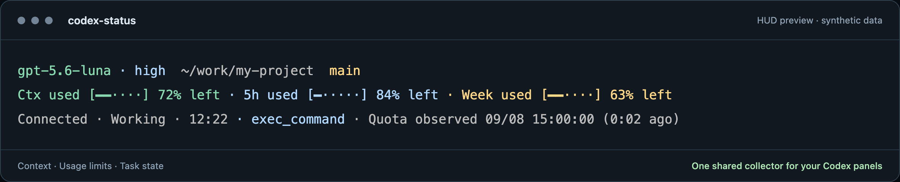

# Codex Status

**Your model, context, and quota. Right below your Codex session.**

A three-row HUD for people running multiple Codex terminals, distributed as a single Go executable. No Python, C compiler, or Go installation is needed to run a release binary.



*The accepted HUD layout, captured from the previous renderer with synthetic example data. This image is not live account data.*

**Early alpha:** macOS (Apple Silicon and Intel), tmux, and official Codex CLI 0.153.4. Other Codex versions remain unverified. This is an independent project, not an OpenAI product.

## Install

Download the macOS archive for your architecture from a release that includes Go binaries: `darwin_arm64` for Apple Silicon or `darwin_amd64` for Intel. Extract it, then run:

```sh
./install.sh
codex-status
```

The installer copies the executable into `~/.local/bin`. Add that directory to PATH if needed. After installation, you can remove the extracted archive. Existing Python releases do not include these binaries.

To install somewhere else:

```sh
./install.sh --bin-dir /absolute/path/to/bin
```

Or build from this checkout with Go 1.25 or later:

```sh
go test ./...
./install.sh
```

The official `codex` executable and tmux must be on PATH. The installer does not change the official Codex command. It refuses to replace unrelated files or symlinks.

## Everyday use

```sh
codex-status
codex-status --resume SESSION-UUID
codex-status -- --model MODEL
```

- **Scroll:** use the mouse wheel over the Codex pane. Scrolling enters tmux history, rather than recalling earlier input. Press `q` to return to the live pane.
- **Close the session:** close the terminal or press `Ctrl-b`, then `d`. Codex and its HUD exit when the last client disconnects; resume the conversation in a new terminal.
- **Close only the HUD:** select the lower pane with `Ctrl-b`, then Down; press `Ctrl-b`, then `x`.
- **Finish:** exit Codex normally. Its paired HUD closes. The shared collector exits after the last HUD disconnects.

The launcher's dedicated tmux server enables mouse handling and hides the default tmux status bar. It does not read or change your personal tmux configuration. Terminal text selection may require holding Shift while dragging.

For optional shell integration, call `codex-status --wrap` with your original Codex arguments. Explicit UUID resumes open with the HUD; informational commands and unsupported entry modes pass through to the official CLI. `CODEX_STATUS_CODEX` can select its executable path.

Each launch uses its own tmux socket. Reattach using the run's UUID and your user ID:

```sh
tmux -S /tmp/codex-status-go-UID/tmux-RUN-UUID.sock attach
```

## Display

| Row | Information |
| --- | --- |
| Session | Model, reasoning effort, working directory, Git branch |
| Capacity | Context tokens and usage, 5H/7D usage and reset countdowns |
| Activity | Observed task state, elapsed time, cache tokens and hit rate |

Bars and percentages show **used** capacity. Context percentage follows Codex's reserved-token calculation. Cache hit rate is cached input divided by input tokens. Missing quota windows display `n/a`, not zero.

Before the first prompt, account quota can already appear. Until Codex creates its session log, the HUD displays a ready state. Model-specific quota buckets, billing estimates, aggregate agent progress, and indirect resume selectors are outside the current scope.

Colored output includes terminal hyperlinks: directory opens the local folder, branch opens its Git remote, quota opens the Codex usage dashboard, and elapsed opens the exact session log. In Orca on macOS, use Cmd-click. The terminal controls the required modifier. Embedded Git credentials are stripped from links.

## Collection and privacy

One collector serves multiple panels over a private local socket. It binds to an exact Codex process start identity, executable, account home, and unique root rollout. Ambiguous or unsupported bindings stay pending. Darwin process inspection uses libproc directly without starting Python, ps, or lsof.

Hidden panels pause rollout reads and do not start account queries. Visible panels share a quota query per account home and executable, cached for 180 seconds. Account-file metadata changes invalidate cached observations. The HUD never reads credential contents. Startup quota uses the official app-server `account/rateLimits/read`; no model request is made.

Only selected telemetry fields leave the rollout reader. Read budgets, record size limits, and terminal sanitization bound processing. Runtime metadata does not contain prompts, tool arguments, or environment contents. Local processes running as your user share the runtime trust boundary.

## Build and verify

```sh
go test -race ./...
go vet ./...
./scripts/build-release.sh
```

The build produces macOS arm64 and amd64 archives and SHA-256 checksums under `dist/`, with `CGO_ENABLED=0`. Release consumers need neither Go nor an SDK. The test suite uses synthetic session fixtures and owned tmux sockets; it does not send model requests.

Previous Python/native-client CPU measurements do not characterize this Go implementation. Linux and Windows releases are not supported in this alpha.

## Update and uninstall

Install the new archive over the existing executable with `./install.sh`. Running sessions continue using their existing process. Start a new session to use the new version.

For migration from the Python installer, first preserve or remove the old `codex-status` symlink, then install the Go executable. Keep the old checkout until its running sessions have exited; they may still import its Python modules. Go uses a separate collector directory and does not replace those sessions.

To uninstall a default installation, remove `~/.local/bin/codex-status`. Remove any shell integration you added. Leave runtime sockets in place until their sessions finish.

## Feedback and license

See [CONTRIBUTING.md](CONTRIBUTING.md). Include OS, architecture, tmux, Codex, and Codex Status versions. Do not attach raw session logs or authentication files.

Project code uses Apache-2.0, with Apple-derived Darwin ABI material under APSL-2.0 and purego under Apache-2.0. See [NOTICE](NOTICE) and [LICENSES](LICENSES/).

Built by **Captain Dev · HolyGround**

[YouTube](https://www.youtube.com/channel/UCOg67wZ-HgA4I73caIE-ByA) · [Working with AI — course](https://www.holyground.world/ko/garden/captaindev/seeds/commanding-ai) · [More from Captain Dev](https://www.holyground.world/ko/garden/captaindev)
