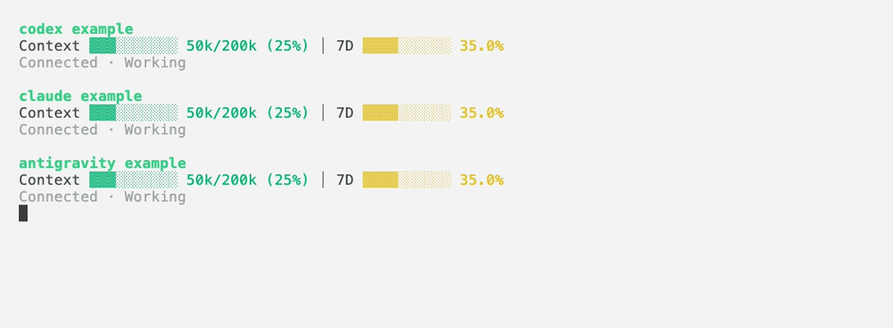

# Codex Status

**Your model, context, and quota. Right below your CLI session.**

A shared three-row HUD for Codex, Claude Code, and Antigravity CLI terminals, distributed as a single Go executable. No Python, C compiler, or Go installation is needed to run a release binary.



*Candidate Codex, Claude Code and Antigravity previews captured from the terminal with synthetic data. This image is not live account data.*

**Early alpha:** macOS (Apple Silicon and Intel) and tmux. Compatible payloads are validated by their fields and session identity, rather than a vendor version pin. See the [compatibility matrix](docs/shared-hud/compatibility.md) for tested features and remaining limits. This is an independent project.

## Install

Download the macOS archive for your architecture from a release that includes Go binaries: `darwin_arm64` for Apple Silicon or `darwin_amd64` for Intel. Extract it, then run:

```sh
./install.sh
codex-status
```

The installer copies the executable into `~/.local/bin`. Add that directory to PATH if needed. After installation, you can remove the extracted archive. Existing Python releases do not include these binaries.

To install somewhere else:

```sh
./install.sh --bin-dir /absolute/path/to/bin
```

Or build from this checkout with Go 1.25 or later:

```sh
go test ./...
./install.sh
```

The official `codex` executable and tmux must be on PATH. The installer does not change the official Codex command. It refuses to replace unrelated files or symlinks.

## Everyday use

```sh
codex-status
codex-status --resume SESSION-UUID
codex-status -- --model MODEL
codex-status run claude --
codex-status setup antigravity
codex-status run antigravity --
codex-status doctor claude
codex-status preview antigravity
```

- **Scroll:** use the mouse wheel over the Codex pane. Scrolling enters tmux history, rather than recalling earlier input. Press `q` to return to the live pane.
- **Detach:** press `Ctrl-b`, then `d`.
- **Close only the HUD:** select the lower pane with `Ctrl-b`, then Down; press `Ctrl-b`, then `x`.
- **Finish:** exit the native CLI normally. Its paired HUD closes. The manager exits when no registered native sessions or views remain.

The launcher's dedicated tmux server enables mouse handling and hides the default tmux status bar. It does not read or change your personal tmux configuration. Terminal text selection may require holding Shift while dragging.

For optional shell integration, call `codex-status --wrap` with your original Codex arguments. Explicit UUID resumes open with the HUD; informational commands and unsupported entry modes pass through to the official CLI. `CODEX_STATUS_CODEX` can select its executable path.

All launches share one owned tmux server with separate sessions. List or reattach using your user ID and the run's UUID:

```sh
tmux -S /tmp/codex-status-go-UID/tmux.sock list-sessions
tmux -S /tmp/codex-status-go-UID/tmux.sock attach -t hud-RUN-UUID
```

## Display

| Row | Information |
| --- | --- |
| Session | Model, reasoning effort, working directory, Git branch |
| Capacity | Context tokens and usage, 5H/7D usage and reset countdowns |
| Activity | Observed task state, elapsed time, cache tokens and hit rate |

Bars and percentages show **used** capacity. Codex context follows its validated reserved-token calculation; other adapters prefer provider percentages. Cache hit rate is cached input divided by input tokens. Only observed quota windows or pools appear. Loading, unavailable data, known binding errors, and measured zero remain distinct.

Before the first prompt, Codex account quota can already appear. Until a native session identity exists, the HUD displays a ready state; Antigravity's empty startup IDs are pending. Billing estimates, aggregate agent progress, and indirect Codex resume selectors are outside the current scope.

Claude receives a per-launch statusLine override; an explicit settings file is merged privately without modifying the original. Antigravity requires explicit setup because its documented callback is persistent. `codex-status uninstall antigravity` restores the prior selected setting while preserving unrelated changes. Unwrapped sessions dispatch the prior custom command when available. A native conversation change without an authoritative transition signal requires relaunching its HUD wrapper.

Colored output includes terminal hyperlinks: directory opens the local folder, branch opens its Git remote, quota opens the Codex usage dashboard, and elapsed opens the exact session log. In Orca on macOS, use Cmd-click. The terminal controls the required modifier. Embedded Git credentials are stripped from links.

## Collection and privacy

One manager serves multiple panels over a private local socket. It binds Codex to an exact process start identity, kernel executable, account home, and unique root rollout. Ambiguous or incompatible bindings show a reason. Darwin process inspection uses libproc directly without starting Python, ps, or lsof.

Hidden panels pause rollout reads. Codex views share one startup quota observation per profile/auth generation through official app-server `account/rateLimits/read`; later changes come from session observations. API-key/custom-endpoint sessions do not use that startup helper. No speculative periodic account polling is started. Account-file metadata changes invalidate observations; credential contents are not read.

The scoped-account registry merges only verified service/principal/billing-realm identities and keeps context separate per session. Current native surfaces do not prove that scope for each live process, so **native verified-account merging is unavailable in this alpha**. Those connections remain isolated within the same manager. See [account sharing](docs/shared-hud/account-sharing.md).

Each launcher forwards its environment to its runner over a private one-use socket before replacing itself with the tmux client. Environment contents are never stored in runtime files or logs. Optional idle worker retention defaults to 30 seconds; `CODEX_STATUS_IDLE_GRACE_SECONDS` accepts 0–60 seconds when starting a new manager.

Only selected telemetry fields leave the rollout reader. Read budgets, record size limits, and terminal sanitization bound processing. Runtime metadata does not contain prompts, tool arguments, or environment contents. Local processes running as your user share the runtime trust boundary.

## Build and verify

```sh
go test -race ./...
go vet ./...
./scripts/build-release.sh
```

The build produces macOS arm64 and amd64 archives and SHA-256 checksums under `dist/`, with `CGO_ENABLED=0`. Release consumers need neither Go nor an SDK. The test suite uses synthetic session fixtures and owned tmux sockets; it does not send model requests.

Previous Python/native-client CPU measurements do not characterize this Go implementation. Linux and Windows releases are not supported in this alpha.

## Update and uninstall

Install the new archive over the existing executable with `./install.sh`. Running sessions continue using their existing process. Finish v0.2 HUD sessions before starting v0.3: the launcher preserves an incompatible running manager and reports the upgrade requirement instead of starting a duplicate. New sessions use the new version.

For migration from the Python installer, first preserve or remove the old `codex-status` symlink, then install the Go executable. Keep the old checkout until its running sessions have exited; they may still import its Python modules. Go uses a separate collector directory and does not replace those sessions.

To uninstall a default installation, remove `~/.local/bin/codex-status`. Remove any shell integration you added. Leave runtime sockets in place until their sessions finish.

## Feedback and license

See [CONTRIBUTING.md](CONTRIBUTING.md). Include OS, architecture, tmux, Codex, and Codex Status versions. Do not attach raw session logs or authentication files.

Project code uses Apache-2.0, with Apple-derived Darwin ABI material under APSL-2.0 and purego under Apache-2.0. See [NOTICE](NOTICE) and [LICENSES](LICENSES/).

Built by **Captain Dev · HolyGround**

[YouTube](https://www.youtube.com/channel/UCOg67wZ-HgA4I73caIE-ByA) · [Working with AI — course](https://www.holyground.world/ko/garden/captaindev/seeds/commanding-ai) · [More from Captain Dev](https://www.holyground.world/ko/garden/captaindev)
